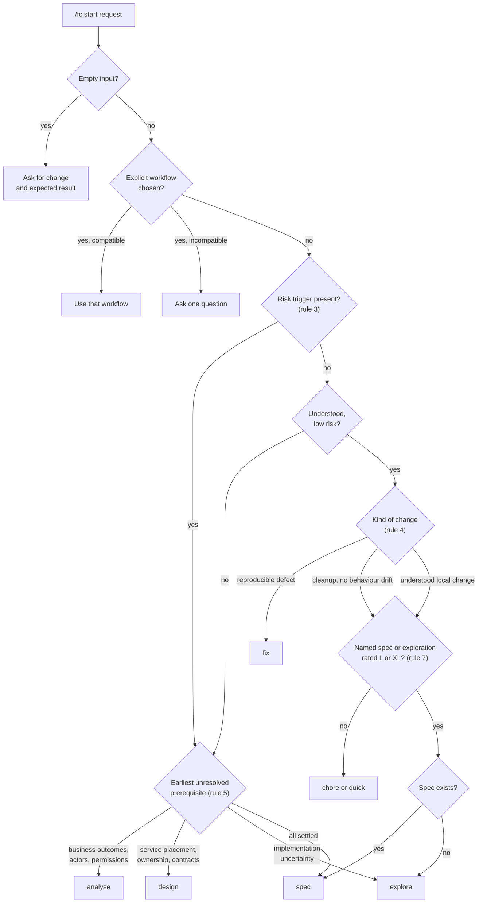

# Choosing a workflow

[← Back to index](README.md)

You can call any command directly. If you are not sure which one fits, `/fc:start <request>` (Codex `$fc-start`) picks one for you, explains why in a sentence, and hands your original request to that command once.

```
/fc:start Change the setup heading to Installation
```

`/fc:start` only classifies. It changes no files, never resumes a delivery, and never chains phases: the chosen command stops at its own normal boundary, and you run the next one. Its only destinations are `quick`, `fix`, `chore`, `analyse`, `design`, `explore` and `spec`. It is interactive only; headless `TASK=start` stops before launching anything, so CI must name the task directly.

## The routing rules

The rules come from [`tasks/start.md`](../skills/ai-layout/templates/ai-factory/tasks/start.md). The key idea: **risk before size, and effort after risk.**



Where each destination leads:

- `fix` → [Fix workflow](workflows/fix.md)
- `chore` → [Chore workflow](workflows/chore.md)
- `quick` → [Quick change](workflows/quick.md)
- `explore`, `analyse`, `design` → [Exploration workflow](workflows/exploration.md)
- `spec` → [Feature workflow](workflows/feature.md)

### Rule by rule

| Rule | What it says |
|---|---|
| 1 | Empty input returns a question. A missing workspace or task returns `blocked` with adoption or drift guidance; nothing is repaired silently. |
| 2 | An explicit workflow choice is respected when compatible with project rules. If incompatible, start asks the smallest question instead of overriding it. |
| 3 | **Risk before size.** Uncertain requirements, authorization, public contracts, migrations, dependencies or service ownership require planned work, even for a one-line change. Only when a trigger is present does the reason mention `/fc:risk` as an optional next step. |
| 4 | Understood low-risk work: `fix` for a reproducible defect, `chore` for explicit cleanup with no behaviour drift, otherwise `quick`. A wording, heading or label change is `quick`. |
| 5 | Planned work goes to the earliest unresolved prerequisite: `analyse` for business outcomes, actors or permissions; `design` for placement, ownership or cross-service contracts; `explore` for implementation uncertainty; `spec` only when everything is settled. Existing artefacts can settle a prerequisite. |
| 6 | Only the seven destinations above are allowed, and the task file must exist. |
| 7 | **Effort after risk.** Start reads an effort rating only from a spec or exploration whose path the request names (the spec's wins if both are named). L or XL never routes to `quick` or `chore`; `fix` stays allowed. It routes to `spec` if a spec exists, otherwise `explore`. S or M changes nothing. |

The effort rating comes from the [effort rubric](how-it-works.md#the-effort-rubric).

## What start returns

Exactly one JSON object, which the session validates before dispatching:

```json
{"status":"route","task":"explore","reason":"Touches a public API; rated L in the named exploration.","effort":"L"}
```

`status` is `route`, `question` or `blocked`. `effort` appears only when rule 7 read a rating.

## Quick reference without start

From [workflow.md §3](../ai-factory/docs/workflow.md#3-which-command-do-i-want):

| If the request is… | Run |
|---|---|
| a bug | `/fc:fix` |
| a small chore, no behaviour change | `/fc:chore` |
| a small, understood local change | `/fc:quick` |
| a business description: actors, rules, permissions, undecided policy | `/fc:analyse`, then `/fc:spec` |
| across a service boundary, a contract change, or homeless | `/fc:design`, then `/fc:adr`, then `/fc:spec` |
| buildable more than one way | `/fc:explore`, then `/fc:spec` |
| otherwise | `/fc:spec` |

`/fc:explore` is mandatory when a request could be built more than one way or touches a queue contract, a schema or a public API.

## Related

- [How it works](how-it-works.md)
- [Commands](commands.md)
