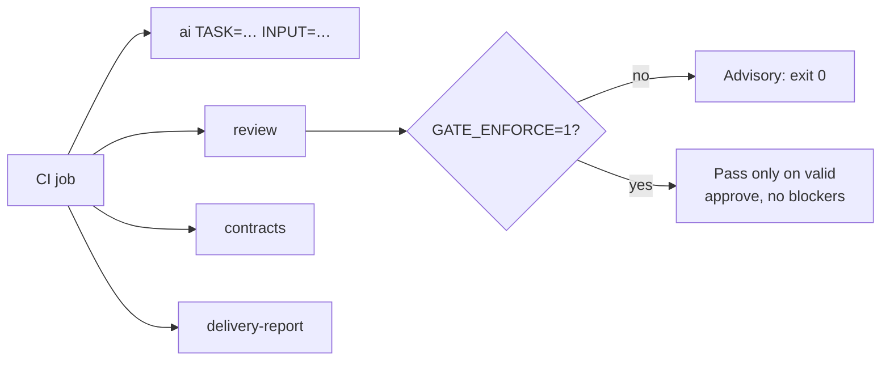

# Headless runs and CI

[← Back to index](README.md)

Every project task except `start` and `continue` also runs without an interactive session, through one make file shipped in the workspace. Adopted repos need no root Makefile and no project adapters.

```
make -f ai-factory/make/ai.mk <target> [VAR=value …]
```



Targets on this page: [`ai`](#run-any-task) · [`review`](#the-review-gate) · [`TASK=loop`](#taskloop-exit-codes) · [contracts and report](#contract-gates) · [other targets](#other-targets)

## Run any task

```
make -f ai-factory/make/ai.mk ai TASK=chore INPUT="bump the node version"
make -f ai-factory/make/ai.mk ai TASK=review INPUT_FILE=some.diff
```

- `TASK` is any file name in `ai-factory/tasks/`, custom ones included.
- `TOOL=claude|codex` picks the CLI.
- `MODEL=<id>` pins the model; `MODEL=` (blank) requests the CLI's own configuration. Otherwise `ai-factory/models.yaml` decides, as described in [How it works: model routing](how-it-works.md#model-routing). Every run prints its selection to stderr and records it in `ai-factory/runs/<run>.json.model.json`.
- `TASK=start` and `TASK=continue` are interactive only. They stop before launching anything, so CI names the destination task directly.
- A task that would ask a question reports it and stops.
- `CMD` must name a single executable, never a shell fragment.

## The review gate

```
make -f ai-factory/make/ai.mk review                       # staged, unstaged and nonignored untracked changes
make -f ai-factory/make/ai.mk review REVIEW_SCOPE=branch   # the committed branch instead
make -f ai-factory/make/ai.mk review GATE_ENFORCE=1        # fail unless approved
```

The `review` target selects the change itself, runs the review task headless and gates the verdict. It differs from `ai TASK=review INPUT=…`, which runs the same task on the input you give it with no gate.

| `GATE_ENFORCE` | Result |
|---|---|
| unset or `0` | Advisory. The verdict is reported; the job does not fail on it. |
| `1` (or the `strict` assurance preset) | Passes only on a schema-valid `approve` with no blockers. `request_changes`, a malformed verdict or a missing one fails. |

`TASK=check`, the deprecated name, still runs the review task and says so on stderr. The shortcuts `TASK=ba` and `TASK=analyze` run `analyse`, and `TASK=scout` runs `explore`, with no notice on stderr.

## `TASK=loop` exit codes

```
make -f ai-factory/make/ai.mk ai TASK=loop INPUT="PMB-003"
```

Runs `/fc:loop` headless. It asks nothing. A usage error or an invalid plan launches nothing.

| Code | Meaning |
|---|---|
| `0` | Every step ticked and the review ran. |
| `1` | A step failed or timed out. |
| `2` | Usage error. |
| `3` | Plan validation failed (missing `Depends on:` reference, cycle, withdrawn step left unticked). |
| `4` | Merge conflict, refused apply, or failed worktree snapshot. |
| `5` | With the review gate enforced (`GATE_ENFORCE=1` or the `strict` assurance preset), the review was not a valid `approve` with no blockers. |

GNU make reports every recipe failure as 2. To tell causes apart, call the runner directly: `TASK=loop INPUT="…" node ai-factory/make/runner.js ai`. `INPUT` is split at whitespace with no quoting, so name a plan whose path holds a space by its number.

## Contract gates

With [artifact contracts](how-it-works.md#opt-in-layers) enabled:

```
make -f ai-factory/make/ai.mk contracts JSON=1                            # nonzero on anything not valid
make -f ai-factory/make/ai.mk contracts DELIVERY=<id> REQUIRE=final,review
make -f ai-factory/make/ai.mk verify DELIVERY=<id> STEP=S2 PHASE=step      # run a step's declared checks, record evidence
make -f ai-factory/make/ai.mk review DELIVERY=<id>                        # also records review evidence
make -f ai-factory/make/ai.mk delivery-report DELIVERY=<id>               # exit 0 only when ready
```

Keep `ai-factory/reports/<id>/completion.md` as a job artifact.

## Other targets

| Target | Does |
|---|---|
| `ids-check` | Artefact ID clash check, for after a merge. |
| `cost` | Token spend from the run log by task, agent, branch and day. `JSON=1` or `TSV=1` for machines. |
| `lifecycle [DELIVERY=<id>] [JSON=1]` | Opt-in lifecycle telemetry per delivery. Never changes a job's exit status. |
| `lifecycle-export DELIVERY=<id> [JSON=1]` | Write the delivery's telemetry export to `ai-factory/runs/telemetry/<id>.json`, the file `delivery-report` reads when lifecycle telemetry is not enabled. `DELIVERY` is required and must look like `d-YYYYMMDD-xxxxxx`; without it the export exits 2. `JSON=1` also prints the export. |
| `ai-sync` | Run `ai-factory/make/sync-adapters.sh` with no arguments, which is strict workspace mode: it prints a notice and changes no file. To write host adapters, call the script directly with `--adapters=claude,codex,cursor,routing` (any subset) or `--adapters=all` (claude, codex and cursor). |
| `log-flush` | Move pending run-log rows into `log.csv` after committing from a terminal. |
| `clean-runs` | Delete headless run outputs older than 30 days. |

## Related

- [Commands](commands.md)
- [How it works](how-it-works.md)
- [workflow.md §6, Headless, for CI](../ai-factory/docs/workflow.md#6-headless-for-ci)
