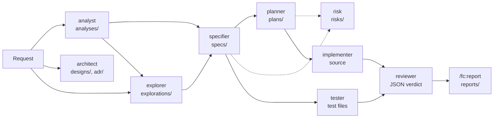

# How it works

[← Back to index](README.md)

The factory has three parts:

1. **`ai-factory/`** in your repo: project context, task procedures, agent copies, and the artefacts each step leaves behind.
2. **`/fc:*` commands** (Claude Code) and **`$fc-*` skills** (Codex). Each project command first runs the model-routing dispatch, then loads the matching `ai-factory/tasks/<name>.md` from your repo, so project edits to a procedure take effect. Plugin-level commands such as `/fc:adopt-sdlc`, `/fc:doctor`, `/fc:sync-sdlc` and `/fc:state` run from the plugin and read no task file.
3. **Nine agents**, each with one narrow role and its own tool permissions.

If a command keeps needing steering in chat, the procedure is missing a line. Fix `ai-factory/tasks/<name>.md` instead of repeating yourself.

## Handoff through files

Agents do not share chat context. Each one reads the previous artefact from disk and writes the next one. That makes every step reviewable, re-runnable and diffable on its own.



Dashed lines are optional. All paths are under `ai-factory/`, except test files and source.

| Phase | Agent | Command | Reads | Writes |
|---|---|---|---|---|
| Architecture | `architect` | `/fc:design`, `/fc:adr` | `ai-factory/docs/fleet.md` | `ai-factory/designs/`, `ai-factory/adr/` |
| Requirements | `analyst` | `/fc:analyse` | feature description | `ai-factory/analyses/` |
| Options | `explorer` | `/fc:explore` | code, `ai-factory/analyses/` | `ai-factory/explorations/` |
| Specification | `specifier` | `/fc:spec` | `ai-factory/analyses/`, `ai-factory/explorations/`, latest `ai-factory/risks/` section | `ai-factory/specs/` |
| Planning | `planner` | `/fc:plan` | `ai-factory/specs/` | `ai-factory/plans/` |
| Risk | `risk` | `/fc:risk` | one spec, plan or change | `ai-factory/risks/` |
| Acceptance tests | `tester` | `/fc:test` | spec ACs, implementation's public surface only | test files |
| Implementation | `implementer` | `/fc:run`, `/fc:loop` | `ai-factory/plans/` (one step) | source and tests |
| Review | `reviewer` | `/fc:review` | the diff, spec, plan, standards, latest risk section | JSON verdict |
| Handoff | none | `/fc:report` | contract sidecars and evidence | `ai-factory/reports/<id>/` |

Two properties come from this design:

- **The tester is blind to the implementation.** It derives tests from the spec's acceptance criteria, so they fail first, and the implementer cannot redefine what "done" means.
- **The reviewer is independent and read-only.** It judges the diff against the spec, plan and coding standards, never against its own work.

When a command delegates to an agent, the session keeps only what a session can do: refuse an empty argument, ask a question, resolve a tracker key, and relay the agent's report. `/fc:fix`, `/fc:chore`, `/fc:quick` and `/fc:fleet` delegate to no agent and run in the session.

## The agents

| Agent | Role | Never does |
|---|---|---|
| `explorer` | Reads the code and writes 2–4 options with a comparison and one recommendation. | code |
| `specifier` | Writes Given/When/Then criteria. Anything implicit becomes an open question. | the plan or code |
| `planner` | Turns one spec into steps sized for one `/fc:run`, each naming its tests. | code |
| `implementer` | Implements exactly one step, verifies its phase, ticks the box. | the next step |
| `tester` | Writes acceptance tests from the ACs. | production code |
| `reviewer` | Reviews the selected diff. Read-only, JSON verdict. | edits |
| `architect` | Decides where a capability belongs; writes designs and ADRs. | source, specs, plans |
| `analyst` | Writes a requirements pack, keeping facts, assumptions and open questions apart. | specs, plans, code, invented policy |
| `risk` | Assesses security threats and delivery risk; records findings with severity, status, evidence and mitigation. | code, accepting a finding |

Canonical agents live in the plugin's [`agents/`](../agents/). Each adopted repo gets copies in `ai-factory/agents/`; add project-specific checks there.

## Project-prefixed IDs

Since 4.0.0, each new artefact is named `<PREFIX>-<NNN>-<slug>.md`, for example `PMB-007-csv-export.md`. The prefix is chosen at adoption and stored in `ai-factory/project.json`. `node ai-factory/make/ids.js new <kind> <slug>` is the only thing that takes the next number; prompts call it and never count.

One feature keeps one ID across kinds: a spec shares its ID with at most one exploration or analysis, one plan and one risk assessment. Legacy four-digit (`0007`) and letter-and-digit (`DHW631`) files stay valid and are never renamed. After a merge, `make -f ai-factory/make/ai.mk ids-check` finds clashes, since two branches can take the same number.

## Effort and risk triage

The ASD-001 change gives explorations, specs and plans a shared size estimate and a short risk triage. The full spec is [ASD-001](../ai-factory/specs/ASD-001-effort-and-risk-triage.md).

### The effort rubric

The explorer, specifier and planner carry the same rubric. Effort has two dimensions, each rated S, M, L or XL. **The final effort is the higher of the two**: size M with uncertainty L is effort L.

| Rating | Size | Uncertainty |
|---|---|---|
| S | 1 file, under 50 lines, no new tests | a known pattern with no unknowns |
| M | 2–5 files, with tests | a known pattern with minor unknowns |
| L | more than 5 files, or a new artefact or check | a new pattern or several unknowns |
| XL | cross-cutting work, or work that needs an ADR or a migration | unknowns that need an exploration or a spike |

Where the rating appears:

| Artefact | Carries |
|---|---|
| Exploration | An effort per option with a reason, and an `Effort and risk` subsection for the recommended option. No time figures. |
| Spec | A `## Effort and risk` section before Open questions: one effort for the whole feature, plus `dev <low>–<high> h` and `/fc:run ~<low>–<high> min`, each labelled as an assumption. It is an independent estimate, not a sum of plan steps. |
| Plan step | One line in the step body: `Effort: <S\|M\|L\|XL> · Estimate: dev <range> h, /fc:run ~<range> min (assumption: …)`. Never in the title line, never summed, never turned into a date. |
| `/fc:start` result | An optional `effort` field when it read a rating (see [Choosing a workflow](choosing-a-workflow.md)). |

### The risk triage

The spec's `Effort and risk` section marks each item `present` or `absent`, with one line of evidence:

- the eight risk categories: authorization, data exposure, secrets, injection, dependency/supply chain, migrations, rollback, blast radius;
- the six `/fc:start` risk triggers: uncertain requirements, authorization, public contracts, migrations, dependencies, service ownership.

The triage has no severity, status or mitigation. The full assessment is `/fc:risk`'s job. When any item is `present` and no risk file exists for the spec, the spec's Open questions contain "Run `/fc:risk <spec path>`". A spec with open questions is not buildable.

After `/fc:risk` writes `ai-factory/risks/<ID>-*.md`, re-running `/fc:spec` on that spec's path revises it in place: it removes the "Run `/fc:risk`" line and adds the latest open blocker and major findings to Open questions, citing the risk file. Nothing else in the spec changes.

## Model routing

No model configuration is required. To pin a model per task, enable routing in `ai-factory/models.yaml`:

```yaml
routing:
  enabled: true
  tasks:
    plan:
      claude: gateway/planning-claude
      codex: gateway/planning-codex
```

The model is resolved once per task, first match wins: explicit `MODEL=` or `--task-model=`, then `routing.tasks.<task>.<tool>`, then `review:` (for review only), then the tool's default entry, then the CLI's own configuration. A blank entry inherits, so any provider or gateway works.

Interactively, each `/fc:<task>` first runs `node ai-factory/make/models.js dispatch`, which prints one directive:

| Directive | What the session does |
|---|---|
| `legacy` | Routing is off; the task runs as before. |
| `inherit` | Routing is on but this task has no model; it runs on the session's model. |
| `route` | Launch the generated worker agent pinned to the model; the chat only relays. |
| `session` | `/fc:continue` and `/fc:loop` only, routing on: they run in this session and never in a worker. Continue's one destination and each loop step run under that task's own model policy. |
| `blocked` | Stop and report. Nothing runs on another model. |

Workers are generated by `bash ai-factory/make/sync-adapters.sh --adapters=routing` (or `/fc:sync-sdlc --adapters=routing`). Restart the session afterwards; agent files load at start. Full detail: [workflow.md, Choosing a model per task](../ai-factory/docs/workflow.md#choosing-a-model-per-task-opt-in).

## Hooks

Hooks are registered plugin-wide, do nothing in repos without `ai-factory/`, and never print to stdout.

- **Dont-touch guard.** Blocks edits to paths in `ai-factory/docs/dont-touch.md`, including rename targets and symlinks. A missing or malformed policy blocks edits. It is not a shell sandbox.
- **Run log.** One row per turn and per concluded subagent in `ai-factory/runs/log.csv`, with `task` and `agent` columns. `make -f ai-factory/make/ai.mk cost` groups token spend by task, agent, branch and day.

Detail: [workflow.md §9](../ai-factory/docs/workflow.md#9-what-the-hooks-record).

## Opt-in layers

All are off until a repo enables them.

| Layer | Enable | Adds |
|---|---|---|
| Artifact contracts | `node ai-factory/make/contracts.js enable` | A `.contract.json` beside each spec, plan and quick checklist, and recorded evidence for every check. Needed by `/fc:continue`, `/fc:report` and `/fc:state --delivery`. |
| Completion report | contracts on | `/fc:report <delivery id>` writes `ai-factory/reports/<id>/completion.md` and `.json`. |
| Lifecycle telemetry | `"lifecycle": {"enabled": true}` in `ai-factory/contracts/config.json` | Elapsed, waiting and active time, retries, outcomes and attributed tokens per delivery. |
| Assurance presets | `node ai-factory/make/assurance.js set <light\|standard\|strict> --apply` | One choice that sets minimum checks for every delivery. |

Detail: [workflow.md, Artifact contracts](../ai-factory/docs/workflow.md#artifact-contracts-opt-in) and [README, Assurance presets](../README.md#assurance-presets-opt-in).

## Related

- [Choosing a workflow](choosing-a-workflow.md)
- [Feature workflow](workflows/feature.md)
- [Commands](commands.md)
- [Headless runs and CI](headless-ci.md)
