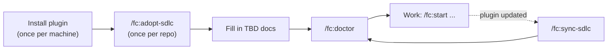

# Installation and setup

[← Back to index](README.md)

You install the plugin once per machine and adopt it once per repo. After that, every `/fc:*` command works in that repo.



## 1. Install the plugin

### Claude Code

```
/plugin marketplace add git@github.com:taninvova/ai-sdlc.git
/plugin install fc@sdlc
```

To work on the plugin itself, run `claude --plugin-dir .` from its repo root.

Restart the session (or run `/reload-plugins`) after installing or updating. Commands and hooks load at session start, so a plugin installed mid-session is not running yet.

### Codex

```
codex plugin marketplace add /absolute/path/to/ai-sdlc
codex plugin add fc@sdlc
```

In the desktop app, install `fc` from the configured `sdlc` marketplace. Start a new session afterwards. Codex uses `$fc-<task>` skills instead of `/fc:<task>`, for example `$fc-adopt-sdlc` and `$fc-start`. Review and trust the plugin's hooks in `/hooks` before you rely on edit guards or logging.

### What you get

- All 28 `/fc:*` commands, visible in every repo before adoption. A project command run in a repo without `ai-factory/` reports the missing workspace instead of creating it.
- Hooks that stay silent outside an adopted repo.
- No model configuration. The plugin uses the model your tool is already configured with.

Host differences (hooks, routing, agent delegation) are listed in [workflow.md §8](../ai-factory/docs/workflow.md#8-using-claude-code-and-codex).

## 2. Adopt a repo

```
/fc:adopt-sdlc                 # detects your stack and, from package.json, its build, lint, typecheck, test and e2e scripts
/fc:fleet                      # fills in ai-factory/docs/fleet.md by asking you
/fc:setup-tracker              # optional: makes /fc:spec ABC-12 resolve a ticket key
/fc:setup-knowledge            # optional: declares an external documentation source (MCP)
```

`/fc:adopt-sdlc` asks once for the project name and an artefact ID prefix (for example Pembina → `PMB`). Every new spec, plan and other artefact is then named `PMB-001-…`, `PMB-002-…`. The prefix is stored in `ai-factory/project.json` and is fixed once written. In a headless run it asks nothing and uses the folder name and the suggested prefix.

Adoption creates only `ai-factory/`. It does not change root files or existing host files such as `CLAUDE.md` or `.claude/`. It refuses if `ai-factory/` already exists; use `/fc:sync-sdlc` there instead.

### What lands in `ai-factory/`

| Path | Holds |
|---|---|
| `AGENTS.md` | What the project is and its real build, lint and test commands. Every task reads it. |
| `project.json` | Project name and ID prefix. |
| `.sdlc.json` | Adoption manifest. Never edit it by hand; a hook blocks it. |
| `docs/` | Context: `architecture.md`, `coding-standards.md`, `definition-of-done.md`, `dont-touch.md`, `fleet.md`, `knowledge.md`, `tracker.md`, `workspace-boundary.md`. |
| `tasks/` | One procedure per project command (`spec.md`, `plan.md`, …). This text is the command's behaviour. Plugin-level commands such as `/fc:adopt-sdlc`, `/fc:doctor` and `/fc:state` have no file here. |
| `agents/` | Project copies of the agents. Add project-specific checks here. |
| `make/` | Helpers: `ai.mk` (headless targets), `ids.js`, `models.js`, `contracts.js`, `loop.js`, … |
| `models.yaml` | Optional per-task model pins and per-model prices. |
| `analyses/`, `designs/`, `adr/`, `explorations/`, `specs/`, `plans/`, `risks/` | The handoff artefacts. See [How it works](how-it-works.md). `reports/`, `evidence/` and `quick/` appear when you use the opt-in layers. |
| `runs/` | The run log (`log.csv`, committed) and local, gitignored logs and scratch. |
| `contracts/` | Opt-in artifact-contract configuration. |

### Fill in what adoption left as TBD

This is the step people skip, and it decides the quality of everything after it. An agent reading a placeholder `architecture.md` produces placeholder-quality work.

| File | What it must say | Who reads it |
|---|---|---|
| `ai-factory/AGENTS.md` | What the project is, the real build, lint and test commands | every task |
| `ai-factory/docs/architecture.md` | Module map, data ownership, what is deliberately absent | explore, plan, design |
| `ai-factory/docs/coding-standards.md` | Rules not obvious from the code | run, fix, chore, reviewer |
| `ai-factory/docs/dont-touch.md` | Paths nothing may edit; a hook enforces it | the edit guard |
| `ai-factory/docs/fleet.md` | Your services, what each owns, what crosses a boundary | design, adr |

## 3. Check the setup: `/fc:doctor`

`/fc:doctor` reports what is wrong with the setup and the command that fixes each thing: layout, adapters, the version the repo records against the version loaded, drift, where the plugin is installed, stale cached copies, tracker and knowledge configuration, and routing problems. It changes nothing and asks nothing, so run it first whenever something looks wrong.

If `/fc:doctor` does not exist, the plugin is not enabled in this repo. Run `/plugin install fc@sdlc` and restart.

Symptoms and causes: [workflow.md §10](../ai-factory/docs/workflow.md#10-when-something-is-wrong).

## 4. Stay current: `/fc:sync-sdlc`

After a plugin update, `/fc:sync-sdlc` compares `ai-factory/` with the installed templates and reports each file:

| It says | What to do |
|---|---|
| upstream changed | Your copy is untouched; safe to take the new version. |
| both changed | You and upstream both edited it; merge by hand. |
| locally modified | Yours; upstream has not moved. Nothing to do. |
| new upstream | Added since you adopted; copy it in if you want it. |
| removed upstream | No longer in the templates; decide whether you still need your copy. |
| missing locally | Received at adoption, but no longer in this repo. |

It only reports. Taking a change is a separate, reviewable edit. It generates host pointers only on explicit request: `--adapters=claude`, `--adapters=codex`, `--adapters=cursor`, or `--adapters=routing` for model-routing workers. It also offers the artifact-contracts opt-in.

## 5. Optional integrations

- **Tracker.** `/fc:setup-tracker` writes `ai-factory/jira.yaml` and proves it by resolving a real key. Then `/fc:spec ABC-12` reads the ticket. Without that file nothing changes.
- **Knowledge source.** `/fc:setup-knowledge` declares an MCP server already attached to your session in `ai-factory/knowledge_base.md`. The explorer, specifier, planner, analyst, architect, reviewer and risk agents read it and label every fact from it as external and unverified. An unreachable source is one report line, never a halt.
- **Opt-in layers.** Artifact contracts (`node ai-factory/make/contracts.js enable`), the completion report, lifecycle telemetry and assurance presets are all off until enabled. See [How it works](how-it-works.md#opt-in-layers).

## Related

- [How it works](how-it-works.md)
- [Choosing a workflow](choosing-a-workflow.md)
- [Commands](commands.md)
- [workflow.md §1–2](../ai-factory/docs/workflow.md#1-install-once-per-machine)
