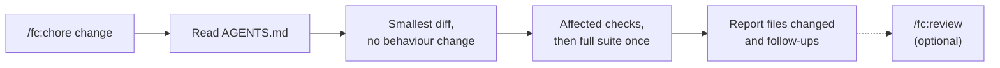

# Chore workflow

[← Back to index](../README.md)

`/fc:chore` makes a small maintenance change with the smallest diff and no behaviour drift. It runs in the session; there is no spec, plan or delegated agent.

```
/fc:chore remove the unused formatDate helper from src/utils
```

With no argument, it asks what to change and stops; it does not go looking for something that seems untidy.



See also: [Choosing a workflow](../choosing-a-workflow.md) · [Commands: /fc:chore](../commands.md#build-and-verify)

## Steps

| # | What happens | Writes |
|---|---|---|
| 1 | Reads `ai-factory/AGENTS.md`. | nothing |
| 2 | Makes the change with the smallest diff. Touches no behaviour beyond the request. | source, tests |
| 3 | Runs affected checks and the project's required completion checks; the full suite once at the end. Prose-only changes get document checks, not invented runtime tests. | nothing |
| 4 | Reports the files changed and anything that should become a spec or an ADR. | nothing |

The same assurance-preset rules as [fix](fix.md#steps) apply when `ai-factory/assurance.json` exists.

The same task runs headless (example from [workflow.md §6](../../ai-factory/docs/workflow.md#6-headless-for-ci)):

```
make -f ai-factory/make/ai.mk ai TASK=chore INPUT="bump the node version"
```

## When to use it, and when not

- **Use** for explicit cleanup or maintenance: for example removing unused helpers or bumping a tool version.
- **Do not use** for a user-facing wording, heading or label change; that is [`/fc:quick`](quick.md). Not every non-runtime edit is a chore.
- **Do not use** when the change carries a risk trigger (authorization, public contracts, migrations, dependencies, service ownership, uncertain requirements). Adding a new dependency, for example, needs an ADR and the [feature workflow](feature.md).
- `/fc:start` never routes to `chore` when the request names a spec or exploration rated L or XL.

## Related

- [Fix workflow](fix.md)
- [Quick change](quick.md)
- [Headless runs and CI](../headless-ci.md)
