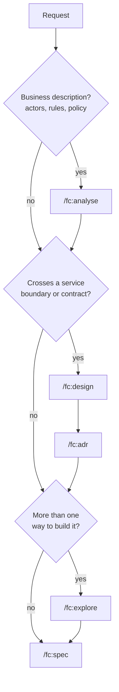

# Exploration workflow

[← Back to index](../README.md)

Three commands settle decisions before a spec is written. Each writes one document and no code.

| Command | Settles | Agent | Writes |
|---|---|---|---|
| `/fc:analyse` | **what** is needed: actors, permissions, rules, states, data, undecided policy | `analyst` | `ai-factory/analyses/<ID>-*.md` |
| `/fc:design` | **where** a capability lives across services, its contract, who owns the data | `architect` | `ai-factory/designs/<ID>-*.md` (+ `/fc:adr`) |
| `/fc:explore` | **how** to build it in one repo whose home is settled | `explorer` | `ai-factory/explorations/<ID>-*.md` |

They run in that order when more than one applies: business needs before service placement, placement before implementation options. `/fc:start` picks the earliest unresolved one.



Next step for every branch: [Feature workflow](feature.md). Routing rules: [Choosing a workflow](../choosing-a-workflow.md).

## Explore: compare implementation options

```
/fc:explore let users export a report as CSV
```

**Use it when** the request could be built more than one way, or touches a queue contract, a schema or a public API (then it is mandatory). Skip it for small obvious changes.

The explorer reads `ai-factory/AGENTS.md`, `architecture.md`, `coding-standards.md` and the code the request would touch, then writes `ai-factory/explorations/PMB-003-csv-export.md` with:

- the request restated and what exists today;
- two to four genuinely different options, each with what it changes, its effort (S, M, L or XL, with a reason) and its risks;
- a comparison table: option · effort · risk · reversibility · fit;
- one recommendation, with an `Effort and risk` subsection: the option's effort and a triage of the `/fc:start` risk triggers. A present trigger recommends running `/fc:risk` once the spec exists. No time figures;
- open questions;
- the `/fc:spec` line to run next.

The session returns the file path and the recommended option in one sentence. If the request is too vague to state any option, the explorer writes nothing and returns a question.

## Analyse: settle what is needed

```
/fc:analyse admins can approve refunds above a limit set per region
```

**Use it when** the request is a business description with several actors, permissions, a lifecycle or policy nobody has decided. A small, understood change does not need it.

The analyst writes a requirements pack: objectives, scope, permission matrix, use cases and lifecycles, functional and non-functional requirements, business rules, data, integrations, stories with Given/When/Then criteria, test scenarios and traceability. Every statement is labelled a supplied fact, assumption, proposal or open question. It invents no policy, estimate or approval. `/fc:spec` reads the pack.

Other modes: `lean` or `questions <description>`, and `review`, `update` or `explain <analysis path>`.

## Design: settle where it lives

```
/fc:fleet                                   # once: fill in the service map
/fc:design refund approvals across billing and orders
/fc:adr Store refund limits in the billing service
```

**Use it when** the capability spans services, changes a contract between them, or has no home yet. The architect reads `ai-factory/docs/fleet.md`, writes a design to `ai-factory/designs/`, and treats an accepted ADR as binding. `/fc:adr` records any decision that outlives the change, and every new dependency, in `ai-factory/adr/`.

`/fc:design review <plan path>` checks a plan for architectural fit and returns a JSON verdict.

## After exploring

Run the `/fc:spec` line the exploration ends with. The spec takes the exploration's ID and builds on the chosen option. Continue with the [feature workflow](feature.md).

## Related

- [Feature workflow](feature.md)
- [How it works: effort and risk triage](../how-it-works.md#effort-and-risk-triage)
- [workflow.md §3](../../ai-factory/docs/workflow.md#3-which-command-do-i-want)
