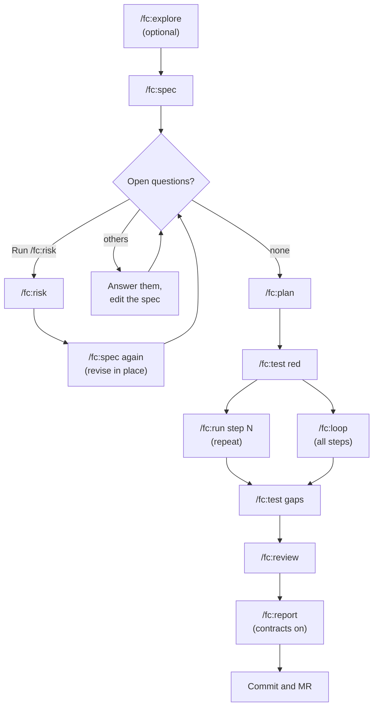

# Feature workflow

[← Back to index](../README.md)

The planned path, for anything that is not a small understood change: new behaviour, uncertain requirements, or work that touches authorization, public contracts, migrations, dependencies or service ownership. Each step is a separate command run by a separate agent, and each leaves a file the next one reads.



Related pages for the diagram: [Exploration](exploration.md) · [Choosing a workflow](../choosing-a-workflow.md) · [Commands](../commands.md)

`/fc:loop` runs every remaining step and then its own `/fc:review`. The diagram simplifies that.

## Before you start

- If the request is still a business description (actors, rules, permissions), run [`/fc:analyse`](exploration.md#analyse-settle-what-is-needed) first.
- If it spans services or changes a contract between them, run [`/fc:design`](exploration.md#design-settle-where-it-lives) first.
- If it could be built more than one way, run [`/fc:explore`](exploration.md). It is optional for small obvious changes.

## The steps

The example adds CSV export to a reports page in a repo whose prefix is `PMB`. The feature keeps one ID, `PMB-003`, across exploration, spec, plan and risk file.

| # | Command | Example | Writes |
|---|---|---|---|
| 1 | `/fc:explore` | `/fc:explore let users export a report as CSV` | `ai-factory/explorations/PMB-003-csv-export.md` |
| 2 | `/fc:spec` | `/fc:spec add CSV export to the reports page` | `ai-factory/specs/PMB-003-csv-export.md` |
| 3 | `/fc:risk` (when the spec asks) | `/fc:risk ai-factory/specs/PMB-003-csv-export.md` | `ai-factory/risks/PMB-003-csv-export.md` |
| 4 | `/fc:spec` again (after risk) | `/fc:spec ai-factory/specs/PMB-003-csv-export.md` | edits the same spec in place |
| 5 | `/fc:plan` | `/fc:plan ai-factory/specs/PMB-003-csv-export.md` | `ai-factory/plans/PMB-003-csv-export.md` |
| 6 | `/fc:test red` | `/fc:test ai-factory/specs/PMB-003-csv-export.md red` | test files that must fail, for the right reason |
| 7 | `/fc:run` | `/fc:run ai-factory/plans/PMB-003-csv-export.md step 1` | code and tests for step 1; ticks its box |
| 7′ | `/fc:loop` (instead of 7) | `/fc:loop PMB-003` | code and tests for every remaining step, uncommitted |
| 8 | `/fc:test gaps` | `/fc:test ai-factory/specs/PMB-003-csv-export.md gaps` | tests for any AC that has none |
| 9 | `/fc:review` | `/fc:review` | nothing; JSON verdict |
| 10 | `/fc:report` | `/fc:report d-20260930-1a2b3c` | `ai-factory/reports/d-20260930-1a2b3c/completion.md` and `.json` |

Then commit as `ai(<task>): …` and open an MR labelled `ai-assisted`.

### 1. Explore

Optional here; see [Exploration workflow](exploration.md). The exploration ends with the `/fc:spec` line to run next.

### 2. Spec

The specifier writes acceptance criteria `AC1…` as Given/When/Then, Out of scope, an `Effort and risk` section and Open questions. It builds on the exploration's chosen option and any analysis. Anything the request leaves implicit becomes an open question, never a criterion. With a tracker configured, `/fc:spec ABC-12` reads the ticket.

**A spec with open questions is not buildable.** Answer them before planning; a plan built on a guess encodes the guess.

### 3–4. Risk, when the spec asks for it

The spec's [risk triage](../how-it-works.md#the-risk-triage) marks the risk categories and start triggers `present` or `absent`. If anything is present, Open questions contain "Run `/fc:risk <spec path>`". The risk agent then assesses threats and delivery risks across eight categories and records each finding with severity, status, evidence and mitigation. It never accepts a finding for you and never gates anything.

Re-run `/fc:spec` with the spec's path. It edits that spec in place: removes the "Run `/fc:risk`" line and adds open blocker and major findings to Open questions. You can also run `/fc:risk` on a plan or on a change at any time; a later run appends a dated Reassessment.

### 5. Plan

The planner turns the spec into ordered `- [ ] Step N` checkboxes. Each step is sized for one `/fc:run`, names the tests that prove it, declares its verification phase (`red`, `step` or `final`), and carries one effort line:

```
- [ ] Step 2 — Write the CSV serializer
  Effort: M · Estimate: dev 2–4 h, /fc:run ~10–20 min (assumption: reuses the existing report query)
  Depends on: 1
```

A step may carry `Depends on: N, M`; without it, a step waits for every earlier step.

### 6. Test red

The tester writes tests from the ACs alone. It reads the implementation's public surface only, never the diff. The tests must fail, and for the documented reason.

### 7. Run, one step at a time

`/fc:run <plan> step N` implements exactly that step, verifies its declared phase, and ticks the box only when the phase passes. It never starts the next step. Let it stop.

### 7′. Or loop

`/fc:loop <plan>` is the one exception to one step per run. It implements every unticked step, running independent steps in parallel (up to `--max-parallel`, 1–8, default 3) in temporary git worktrees under `ai-factory/runs/tmp/worktrees/` on Claude Code and headless, one at a time on Codex. A step running alone runs in the main tree. Each step's change comes back to your tree uncommitted. It stops starting new steps on a failed step, a timeout (`--step-timeout`, default 30 minutes, not enforced on Codex), a conflict or refused apply, or a worktree that could not be prepared; while the review gate is enforced, a review that is not an approval is a stop cause too. It never commits on your branch, and it runs `/fc:review` once, also after a stop.

Test, lint and typecheck tools must exclude `ai-factory/runs/tmp/worktrees/`. Detail: [workflow.md, The rules that make it work](../../ai-factory/docs/workflow.md#the-rules-that-make-it-work).

### 8. Test gaps

Covers any AC that ended up without a test, and flags tests that would still pass if the behaviour were reverted.

### 9. Review

The reviewer reads the selected diff (the working tree by default, or `branch`) against the spec, plan, coding standards, dont-touch rules and the latest risk section. It checks correctness, scope, tests, spec drift, boundaries, security and operability, and returns a JSON verdict. It fixes nothing.

### 10. Report (artifact contracts enabled)

`/fc:report <delivery id>` writes a completion report with one status (`ready`, `incomplete`, `blocked` or `unverified`), every reason tied to evidence, one row per criterion, the checks that ran, review findings, follow-up, and a draft MR description. It reads only that delivery's sidecars, Markdown, evidence and optional telemetry; it runs no check, edits no source artifact and publishes nothing.

## Coming back to a delivery

### `/fc:state`: what is left

```
/fc:state                 # outstanding specs and plans, each plan with its unticked steps
/fc:state --next          # the one to pick up
/fc:state --spec PMB-003  # one spec and its plans
/fc:state --delivery d-20260930-1a2b3c   # one delivery's evidence (contracts on)
```

Run it before `/fc:run` after time away, so you pick up from the artefacts on disk, not from memory. It is read-only and starts nothing. Other flags: `--done`, `--specs`, `--plans`. The `--delivery` view is described in [workflow.md, Delivery status](../../ai-factory/docs/workflow.md#delivery-status).

### `/fc:continue`: resume one delivery

```
/fc:continue d-20260930-1a2b3c
```

Needs artifact contracts. It inspects the delivery's evidence read-only, picks the earliest unsatisfied step, and hands off to exactly one task:

| Delivery state | Runs |
|---|---|
| spec with no plan | `/fc:plan <spec>` |
| first unfinished step declares red, no red evidence | `/fc:test <spec> <plan> red S<N>` |
| first unfinished step (also interrupted or failed) | `/fc:run <plan> S<N>` |
| all steps done, gaps testing not run | `/fc:test <spec> <plan> gaps` |
| review missing or stale | `/fc:review working-tree <spec> <plan>` |
| evidence ready, no report | `/fc:report <delivery>` |

When evidence cannot tell (did gaps testing run?), it asks. If the spec changed after downstream work, it stops and names what may be affected; you reconcile, then run it again. `complete` means ready for handoff, not merged or deployed. It does not take spec or plan paths, quick deliveries, or contracts-disabled repos.

## Rules that keep it working

- One named step per `/fc:run`; `/fc:loop` is the only exception.
- Answer a spec's open questions before planning.
- Plan when risk or uncertainty warrants it. File count alone does not decide the workflow.
- Steering in chat for 20+ minutes with code changed? Stop, write the decision into the plan, commit, continue.

## Related

- [Exploration workflow](exploration.md)
- [How it works](../how-it-works.md)
- [Commands](../commands.md)
- [workflow.md §4, The main loop](../../ai-factory/docs/workflow.md#4-the-main-loop)
