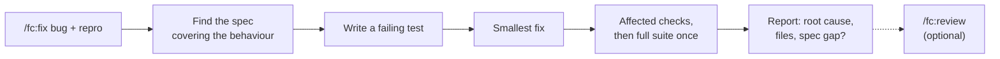

# Fix workflow

[← Back to index](../README.md)

`/fc:fix` reproduces a bug with a failing test, then fixes it with the smallest change that makes the test pass. It runs in the session; there is no spec, plan or delegated agent.

```
/fc:fix exporting a report with an empty date range returns 500; steps: open /reports, clear both dates, click Export
```

Give the symptom and how to reproduce it. With no argument, it asks what the bug is and stops; it does not go hunting for something that looks broken.



See also: [Choosing a workflow](../choosing-a-workflow.md) · [Commands: /fc:fix](../commands.md#build-and-verify)

## Steps

| # | What happens | Writes |
|---|---|---|
| 1 | Reads `ai-factory/AGENTS.md` and `coding-standards.md`, and finds the spec that covers the behaviour. | nothing |
| 2 | Reproduces the bug with a failing test (unit or end-to-end, per the project) **before** changing code. | a test file |
| 3 | Fixes with the smallest change that makes the test pass. No unrelated refactoring. | source |
| 4 | Runs affected checks and the project's required completion checks; the full suite once at the end. After two attempts with no new evidence, it preserves the work and reports the blocker. It never weakens a test. | nothing |
| 5 | Reports the root cause, the files changed, and whether the spec was wrong or incomplete. | nothing |

Then run `/fc:review` if you want an independent review before committing.

With an [assurance preset](../how-it-works.md#opt-in-layers) of `standard` or `strict`, the fix also records a quick-delivery checklist and its verification, needs an independent `make -f ai-factory/make/ai.mk review DELIVERY=<id>`, and claims completion only when `node ai-factory/make/assurance.js complete <id>` exits 0.

## When to use it, and when not

- **Use** for a reproducible defect in understood, low-risk code.
- **Do not use** when the fix touches authorization, a public contract, a migration, a dependency or service ownership, even if it is one line. Risk comes before size; use the [feature workflow](feature.md).
- An effort rating of L or XL does not rule out `fix` in `/fc:start` (it does rule out `quick` and `chore`).
- If the report says the spec was wrong or incomplete, update the spec with `/fc:spec`.

## Related

- [Chore workflow](chore.md)
- [Quick change](quick.md)
- [Feature workflow](feature.md)
