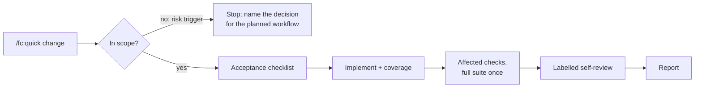

# Quick change

[← Back to index](../README.md)

`/fc:quick` completes a small, well-understood local change: a short acceptance checklist, the implementation, meaningful coverage, focused checks and a labelled self-review. No spec, plan or delegated agent is required just because behaviour changes.

```
/fc:quick Change the setup heading to Installation
```

Give the change and the expected result. With no argument, it asks for both and stops.



See also: [Feature workflow](feature.md) · [Choosing a workflow](../choosing-a-workflow.md)

## Steps

| # | What happens | Writes |
|---|---|---|
| 1 | Checks scope. Uncertain requirements, or a change to authorization, public contracts, migrations, dependencies or service ownership, stops with the decision named. File count alone does not decide. | nothing |
| 2 | Writes a short acceptance checklist in the conversation. With contracts enabled, writes it to `ai-factory/quick/<slug>.md` as `QC1…` items instead. | checklist (contracts only) |
| 3 | Implements the change and meaningful regression coverage. For a bug, shows the failing case first. No unrelated cleanup, no new dependency. | source, tests |
| 4 | Runs affected checks, then the full required suite once. Never weakens a test. With contracts, records `make -f ai-factory/make/ai.mk verify DELIVERY=<id>`. | evidence (contracts only) |
| 5 | Reviews its own diff and calls it a self-review. It never implies independence. | nothing |

## When to use it, and when not

- **Use** for an understood local change, including any user-facing wording, heading or label change.
- **Use [`/fc:fix`](fix.md)** for a reproducible defect and **[`/fc:chore`](chore.md)** for cleanup with no behaviour change.
- **Do not use** for risky or uncertain work, however small. An assurance preset never makes a request eligible for quick.

## Related

- [Fix workflow](fix.md)
- [Chore workflow](chore.md)
- [workflow.md, Workspace defaults and small changes](../../ai-factory/docs/workflow.md#workspace-defaults-and-small-changes)
